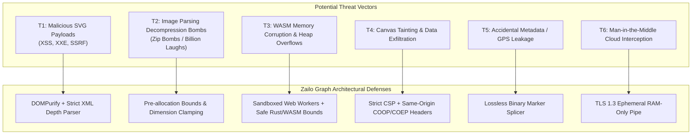

# Zailo Graph — Privacy Architecture & Security Blueprint

**Document Version:** 1.0.0  
**Target Domain:** `zailograph.zorquelz.com`  
**Security Model:** Zero-Knowledge Client-Side Sandbox with Ephemeral Opt-In Fallback  
**Status:** Approved Security Document  

---

## 1. Executive Privacy Charter

At Zailo Graph (a Zorquelz platform), user privacy is not an afterthought or a marketing claim—it is the foundational architectural constraint dictating every technical decision.

### The Five Inviolable Privacy Laws of Zailo Graph
1. **Local-First Zero-Knowledge Sandbox:** All image operations execute entirely within the user's browser runtime by default. No image bytes, thumbnails, filenames, or metadata are ever transmitted over the network without explicit, affirmative user action.
2. **Affirmative Cloud Consent:** Cloud processing is never triggered automatically or silently. If a user's hardware cannot execute a model locally, the system requests per-task affirmative consent explaining exactly what data will leave their device.
3. **Stateless Ephemerality:** When cloud compute is utilized, image bytes exist exclusively in volatile RAM buffers. No user files are ever written to disk, databases, object stores, or persistent caches.
4. **Zero User Tracking & Profiling:** No third-party tracking scripts, advertising pixels, invasive analytics, or cross-site fingerprinting mechanisms are permitted in the codebase.
5. **Lossless Metadata Control:** The user retains complete authority over EXIF, GPS, and device metadata. Sanitization tools guarantee total removal without compromising pixel fidelity.

---

## 2. Threat Modeling & Attack Surface Analysis



### Detailed Threat Scenarios & Mitigations

#### Threat 1: Malicious SVG Uploads (Stored/Reflected XSS, SSRF)
- **Attack Vector:** An attacker crafts an SVG containing `<script>alert(document.cookie)</script>`, embedded `onload` event handlers, or external `xlink:href` references designed to leak IP addresses or execute arbitrary JavaScript within the origin.
- **Architectural Defense:**
  1. SVGs are never rendered by injecting raw HTML into the DOM via `dangerouslySetInnerHTML`.
  2. Input SVGs pass through a strict parser validating the absence of DOCTYPE declarations, entity expansions (`<!ENTITY>`), and script tags.
  3. Final SVG rendering for rasterization uses `@resvg/resvg-wasm` in an isolated Web Worker. `resvg` is a Rust-based renderer that does not contain a JavaScript engine, completely neutralizing script execution vectors.

#### Threat 2: Decompression Bombs & Memory Exhaustion (DoS)
- **Attack Vector:** A user (or malicious link) loads an image that specifies modest dimensions on disk (e.g. 500 KB compressed) but expands to hundreds of gigabytes of uncompressed memory upon decoding (e.g., a $100,000 \times 100,000$ pixel bomb).
- **Architectural Defense:**
  1. **Header-First Inspection:** Before allocating full pixel buffers, workers read the image header markers (SOF0 for JPEG, IHDR for PNG, VP8X for WebP) to determine dimensions.
  2. **Dimension Boundary Clamping:** If $\text{Width} \times \text{Height} > 100,000,000\text{ pixels}$ (100 MP) or uncompressed memory exceeds 400 MB for a single buffer, decoding is rejected immediately with an informative error toast.

#### Threat 3: Canvas Tainting & Cross-Origin Data Exfiltration
- **Attack Vector:** Loading cross-origin images without proper CORS headers can taint the HTML5 canvas, causing `canvas.toBlob()` or `getImageData()` to fail or allow malicious third parties to inspect image data.
- **Architectural Defense:** All image operations run on locally instantiated `File`, `Blob`, or `ArrayBuffer` objects created via user drag-and-drop or local file pickers. No remote URL fetching is performed on the canvas without explicit proxying and strict CORS headers.

#### Threat 4: EXIF GPS & Personal Identity Leakage
- **Attack Vector:** Users upload smartphone photos containing exact GPS home coordinates, device serial numbers, and timestamps to social platforms without realizing the metadata is embedded.
- **Architectural Defense:**
  - The EXIF Viewer highlights privacy-sensitive tags (GPS latitude/longitude, altitude, timestamp, camera serial number) in prominent warning badges.
  - The **EXIF Metadata Removal** utility performs binary marker slicing that strips `APP1` (EXIF) and `APP2` (ICC/XMP) markers from the JPEG byte stream without re-compressing the image, ensuring 100% metadata eradication.

---

## 3. Explicit Cloud Consent Protocol

When local hardware cannot sustain an operation (e.g. lack of WebGPU support for high-res inpainting or a 70 MB RAW demosaicing batch), the application initiates the **Explicit Consent Flow**.

```mermaid
sequenceDiagram
    autonumber
    actor User as User
    participant App as Zailo Graph Frontend
    participant Modal as Consent Modal
    participant Worker as Ephemeral GPU Worker
    
    User->>App: Clicks "AI Inpaint" on unsupported device
    App->>App: Detects WebGPU unavailable & WASM timeout
    App->>Modal: Display Ephemeral Cloud Fallback Dialog
    Note over Modal: Dialog outlines:<br/>1. Exact file size & format<br/>2. Transmission via TLS 1.3<br/>3. RAM-only processing (Zero disk write)<br/>4. Instant deletion upon response
    alt User Denies
        User->>Modal: Click "Cancel"
        Modal->>App: Abort transmission
        App->>User: Keep image local; offer low-res local mode
    else User Consents
        User->>Modal: Click "Proceed with Ephemeral Processing"
        Modal->>App: Generate one-time session consent token
        App->>Worker: POST /api/v1/process (Token + Image Stream)
        Worker->>Worker: In-memory processing
        Worker->>App: Stream result image
        Worker->>Worker: Force free memory buffer
        App->>User: Display completed result in workspace
    end
```

### Consent Modal Specifications:
- **Default State:** The checkbox is unchecked by default.
- **Transparency:** The dialog clearly displays the destination endpoint (`api.Zailo Graph.zorquelz.com`), the encryption standard (TLS 1.3), and states: *"This file will be processed in volatile memory and permanently discarded immediately upon completion. It is never saved to disk or used for AI training."*
- **Granularity:** Users can grant consent for "This image only" or "This session only". Consent expires automatically upon closing the tab.

---

## 4. Zero-Retention Ephemeral Cloud Processing Protocol

For operations utilizing the cloud fallback, the infrastructure adheres to strict zero-retention principles:

1. **Read-Only Container Filesystem:** The compute container is deployed with a read-only root filesystem (`read_only: true` in Docker/Kubernetes).
2. **Volatile Memory Streaming:** Image payloads are read directly into an in-memory byte buffer (`io.BytesIO` in Python). No temporary files (`/tmp`) are created.
3. **Deterministic Memory Zeroing:** After completing the transformation and piping the response stream to the client, the memory buffer is explicitly cleared and Python's garbage collector (`gc.collect()`) is invoked.
4. **Zero Persistent Data Stores:** The compute worker has no attached block storage, no database connections, and no AWS S3/Cloudflare R2 write credentials.
5. **No Persistent Access Logging:** Edge reverse proxies log only high-level operational telemetry (HTTP status, execution duration in milliseconds, bandwidth consumed). The request body, image headers, EXIF data, and IP addresses are completely excluded from permanent logs.

---

## 5. Content Security Policy (CSP) & Isolation Headers

Zailo Graph enforces modern, strict browser headers configured via Cloudflare Pages `_headers`:

### Content Security Policy (CSP)
```http
Content-Security-Policy: 
    default-src 'self';
    script-src 'self' 'wasm-unsafe-eval';
    style-src 'self' 'unsafe-inline';
    img-src 'self' blob: data: https://*.tile.openstreetmap.org;
    font-src 'self';
    connect-src 'self' https://api.Zailo Graph.zorquelz.com;
    worker-src 'self' blob:;
    object-src 'none';
    base-uri 'none';
    form-action 'none';
    frame-ancestors 'none';
    upgrade-insecure-requests;
```

*Key Directives Explained:*
- `'wasm-unsafe-eval'`: Strictly required to allow WebAssembly JIT compilation while prohibiting unsafe JavaScript `eval()`.
- `worker-src 'self' blob:`: Permits spawning Web Workers from local Vite module chunks and blob URLs.
- `object-src 'none'`: Eliminates obsolete Flash/Java plugin exploit vectors.
- `frame-ancestors 'none'`: Prevents clickjacking attacks by forbidding framing of Zailo Graph within third-party `<iframe>` tags.

### Cross-Origin Isolation Headers
```http
Cross-Origin-Opener-Policy: same-origin
Cross-Origin-Embedder-Policy: require-corp
Cross-Origin-Resource-Policy: same-origin
```
Enforcing `COOP` and `COEP` provides:
1. Protection against Spectre-style side-channel memory attacks.
2. Direct access to `SharedArrayBuffer` and high-resolution performance timers (`performance.now()` with sub-millisecond precision), which are mandatory for multi-threaded WASM and WebGPU shaders.

---

## 6. User Account Privacy & Zero-Profile Policy

To unlock competitor-paid utilities (AI models, vectorization, RAW studio, 50MB files, and 50-item batches) for free, users create a free Zailo Graph account. We enforce strict data minimization:

1. **Zero Financial Data:** No credit card, billing address, or payment details are ever requested or stored. Zailo Graph is completely free.
2. **Minimalist Identity:** Accounts use passwordless magic links or standard PKCE OAuth (Google / GitHub). Only the verified email address and account creation timestamp are retained.
3. **Decoupled Processing:** User image operations are never correlated or logged against their user account profile. The server has zero knowledge of which images any specific user account has processed.
4. **Instant Self-Serve Deletion:** Users can permanently delete their account with a single click, completely removing their email and authentication records from the authentication database.

---

## 7. Telemetry & Analytics Policy

- **Third-Party Trackers:** Zero presence. Google Analytics, Facebook Pixel, Mixpanel, and advertising SDKs are strictly barred.
- **Crash Reporting:** If enabled in future releases, crash reporting will be 100% opt-in, privacy-preserving, and scrubbed of all image filenames, dimensions, and personal identifying data (capturing only the stack trace and WebAssembly error code).

