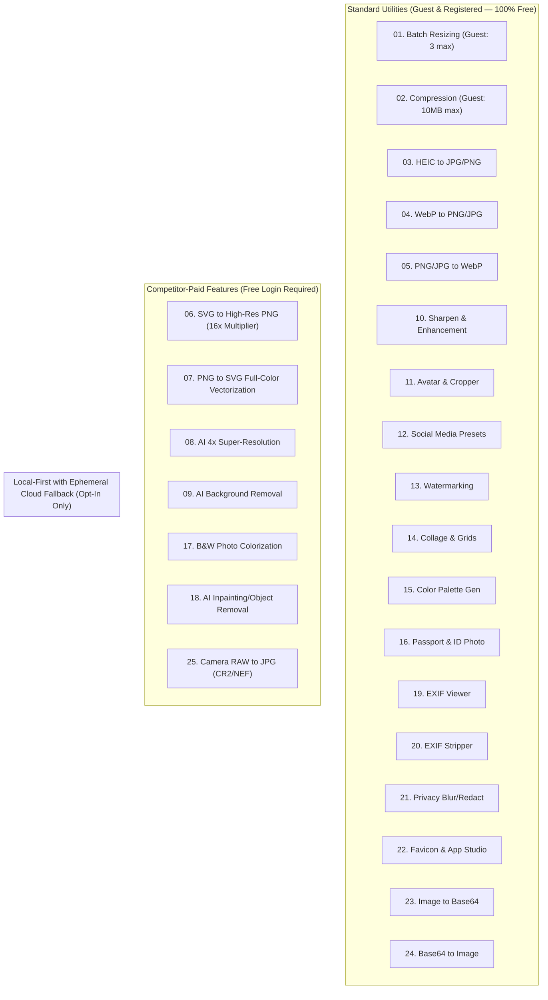
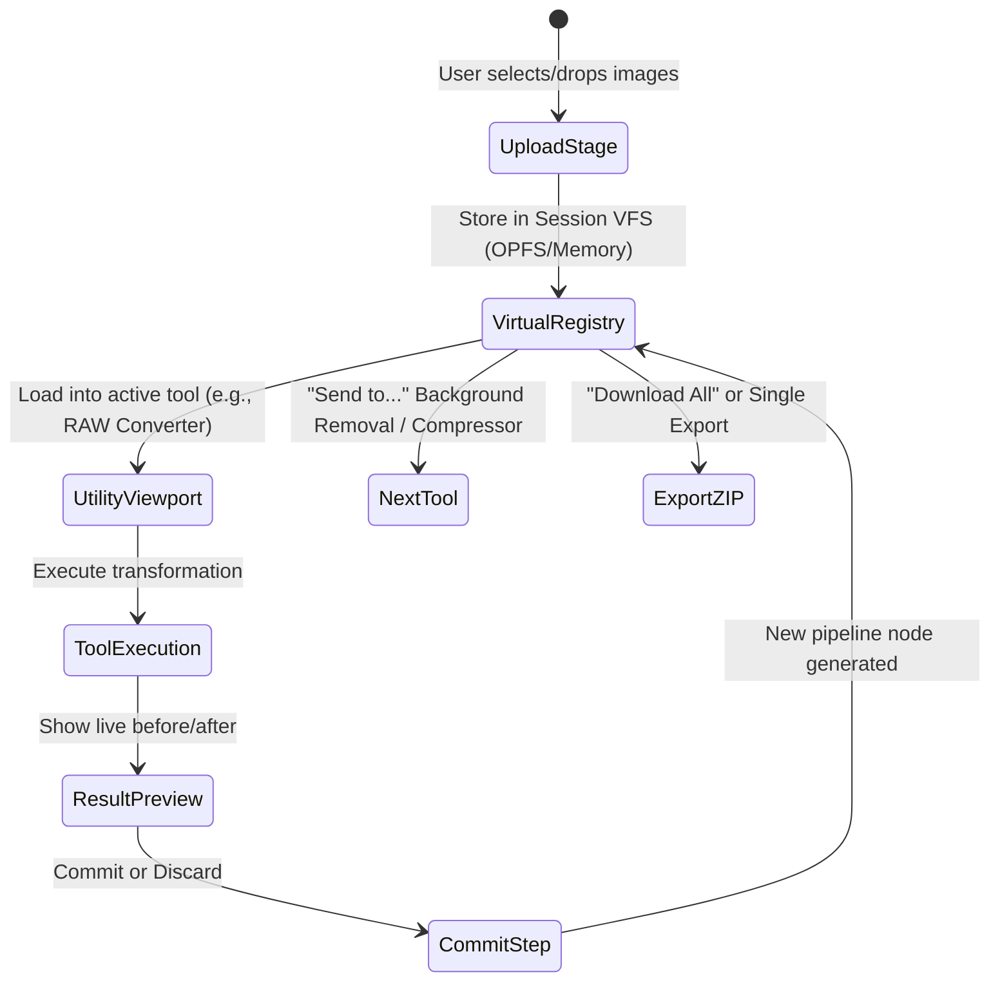

# Zailo Graph — Product Requirements Document (PRD)

**Document Version:** 1.0.0  
**Target Domain:** `zailograph.zorquelz.com`  
**Brand Identity:** Zorquelz  
**Tagline:** *"Your images. Your workflow. Your control."*  
**Status:** Approved Architecture Draft  

---

## 1. Executive Summary & Product Philosophy

Imazora is a professional-grade, privacy-first, web-native image utility workspace developed under Zorquelz. It consolidates 25 disparate image conversion, enhancement, vectorization, redaction, and generative/enhancement AI workflows into a cohesive, non-destructive desktop and mobile workspace.

### Core Tenets
1. **Zero-Knowledge Privacy by Default:** User images never leave the local browser runtime unless the user explicitly opts into a high-compute cloud fallback model.
2. **Free Pro Power via Free Account:** Everything on Imazora is 100% free with zero paywalls, credit cards, or subscriptions. Competitor-paid features (AI background removal, 4x upscaling, inpainting, colorization, vectorization, Camera RAW studio) and enterprise batch limits are fully unlocked simply by logging in.
3. **Guest Tier with Strict Protective Limits:** Anonymous guests can use Imazora immediately without logging in, but operate under strict limits on file size, batch size, and access to standard raster utilities only.
4. **Connected Workflows:** Output from any tool can instantly pipe into another tool (e.g., *RAW to JPG* &rarr; *Background Removal* &rarr; *Social Preset* &rarr; *Compression*) without redundant disk roundtrips.
5. **Deterministic & Transparent:** Clear indication of local WASM/WebGPU execution versus cloud execution, exact file size savings, and raw metadata inspection before saving.
6. **Architectural Resilience:** Explicit memory budgets (handling up to 50 MB raw/high-res files for logged-in users) with proactive crash-prevention and graceful degradation.

---

## 2. Access Tiers: Anonymous Guest vs. Free Registered User

Imazora offers two operational tiers. Both tiers are completely free of financial cost, subscriptions, or credit card requirements.

| Capability / Resource | Anonymous Guest (No Login) | Free Registered User (Logged In) |
| :--- | :--- | :--- |
| **Monetary Cost** | **$0.00** (Free) | **$0.00** (Free, No Card Required) |
| **Max Image File Size** | **10 MB** per image | **50 MB** per image |
| **Max Batch Queue** | **3 images** per batch | **50 images** per batch |
| **Max Export Resolution** | **$1920 \times 1080\text{ px}$ (FHD)** | **Full Resolution (Up to 8K / 96 MP)** |
| **Standard Utilities** (Resize, Crop, WebP, Exif, Redact, Base64, Favicon) | **Full Access** (subject to guest limits) | **Unrestricted Access** |
| **08. AI 4x Super-Resolution** | *Locked* (Requires Free Login) | **Unlocked** |
| **09. AI Background Removal** | *Locked* (Requires Free Login) | **Unlocked** |
| **17. B&W Photo Colorization** | *Locked* (Requires Free Login) | **Unlocked** |
| **18. AI Object Inpainting** | *Locked* (Requires Free Login) | **Unlocked** |
| **07. PNG to SVG Vectorization** | *Locked* (Requires Free Login) | **Unlocked** |
| **25. Camera RAW to JPG (CR2/NEF)** | *Locked* (Requires Free Login) | **Unlocked** |
| **06. SVG 16x High-Res Rendering** | *Capped at 2x ($1920\text{px}$)* | **Full 16x Multiplier (Print DPI)** |
| **Workspace Session Persistence** | Single active browser tab | Persistent session across browser visits |

---

## 3. Core Non-Functional Requirements & Performance Budgets

| Metric / Dimension | Specification | Verification Gate |
| :--- | :--- | :--- |
| **Max Image File Size** | 50 MB initial target per file | Tested across 50MB Canon CR2, Nikon NEF, and 8K PNG files |
| **Max Batch Size** | 50 images concurrently queued | Queue manager limits active concurrent workers to `navigator.hardwareConcurrency - 1` |
| **Memory Ceiling** | $\le 1.8\text{ GB}$ heap allocated per browser tab | Safe limit below the 32-bit WASM 2GB/4GB boundary and Chrome tab crash threshold |
| **Cold Startup Time** | $\le 1.5\text{ s}$ LCP on modern desktop, $\le 2.5\text{ s}$ on mobile 4G | Core bundle $\le 150\text{ KB}$ gzip; all WASM/AI models lazy-loaded on demand |
| **Processing Latency (Local)** | Resizing/Cropping: $< 100\text{ ms}$; Compression: $< 400\text{ ms}$; AI Bg Removal: $< 3\text{ s}$ (WebGPU) | Synthetic benchmarks on mid-tier hardware (e.g., Apple M-series / Intel i5 + Iris Xe) |
| **Cloud Consent Guarantee** | Strict explicit consent modal per session/task | Network interceptors assert 0 outgoing image payloads without signed user approval token |
| **Theme / Design System** | Premium, ultra-clean Light Theme | Contrast ratio $\ge 4.5:1$ (WCAG AA), neutral gray backgrounds, crisp typography |

---

## 4. The 25 Core Utilities — Detailed Specifications

### Utility Matrix Overview & Access Tiers

---

### Detailed Utility Breakdown

#### 01. Batch Image Resizing
- **Inputs:** JPEG, PNG, WebP, AVIF, HEIC, TIFF, BMP (up to 50 items).
- **Parameters:** Exact pixels ($W \times H$), percentage ($1\%\text{--}500\%$), fit modes (`cover`, `contain`, `fill`, `inside`, `outside`), lock aspect ratio, target file size heuristic.
- **Resampling Algorithms:** Lanczos3 (high fidelity), Mitchell-Netravali (balanced), Bilinear (fast batch).
- **Metadata Handling:** Checkbox to preserve or strip EXIF/ICC profiles.
- **Batch Action:** Apply unified sizing or per-image custom sizing. ZIP export with progress indicators.

#### 02. Image Compression
- **Inputs:** JPEG, PNG, WebP, AVIF.
- **Modes:** 
  - *Lossy:* MozJPEG / OxiPNG / libwebp WASM with fine-grained quality slider ($0\text{--}100$).
  - *Lossless:* Metadata stripping, chunk optimization, Huffman table optimization.
- **Visual Feedback:** Interactive split-screen comparison slider (Original vs Compressed) with live byte calculation and SSIM/PSNR visual quality score.

#### 03. HEIC to JPG/PNG Conversion
- **Inputs:** `.heic`, `.heif` (including iPhone Live Photos, Burst sequences).
- **Execution:** Local WASM decoder (`libheif` / `libde265`).
- **Features:** Multi-frame sequence extraction (select frame or export all as ZIP), color profile preservation (Display P3 to sRGB conversion option), transparency preservation when exporting to PNG.

#### 04. WebP to PNG/JPG Conversion
- **Inputs:** Animated or static `.webp`.
- **Outputs:** Static PNG, JPEG, or animated APNG/GIF/frame sequence ZIP.
- **Controls:** Quality selector for JPG, alpha background color replacement (white/black/custom) for non-alpha JPG targets.

#### 05. PNG/JPG to WebP Conversion
- **Inputs:** Any standard raster format.
- **Outputs:** Optimized `.webp`.
- **Options:** Lossless vs Lossy toggle, near-lossless slider, alpha quality, compression effort ($0\text{--}6$).

#### 06. SVG to High-Resolution PNG Conversion
- **Inputs:** `.svg` text or uploaded file.
- **Execution:** Pure client-side via `resvg-js` WASM engine (eliminating browser-specific SVG rasterization bugs).
- **Capabilities:** Scaling multipliers up to $16\times$ (e.g., $16,000 \times 16,000\text{ px}$ subject to memory bounds), custom DPI setting (72, 150, 300, 600 DPI for print), transparent background toggle.

#### 07. PNG to SVG Vectorization
- **Inputs:** Raster graphics (PNG, JPG, WebP), optimized for logos, sketches, and typography.
- **Execution:** `vtracer` WASM (Vision Tracer algorithm).
- **Parameters:** Color mode (color vs B&W), color precision ($1\text{--}8$), filter speckle (noise reduction), corner threshold, curve fitting segment length.
- **Output:** Clean, optimized SVG with live path node inspector.

#### 08. AI Super-Resolution and 4× Upscaling
- **Inputs:** Low-resolution rasters up to $2048 \times 2048\text{ px}$ (output up to $8192 \times 8192\text{ px}$).
- **Engines:**
  - *Local Mode:* Real-ESRGAN / Compact ONNX models via WebGPU. Supports tiled inference to prevent GPU device loss on 50MB source images.
  - *Cloud Fallback:* Ephemeral PyTorch worker if WebGPU is unsupported or VRAM is insufficient.
- **Models:** Real-ESRGAN General (photos), Real-ESRGAN Anime/Illustration (line art).

#### 09. AI Background Removal
- **Inputs:** Any photographic portrait, product shot, or graphic.
- **Engines:**
  - *Local Mode:* RMBG-1.4 / BiRefNet quantized ONNX models running directly via ONNX Runtime Web (WebGPU / WASM SIMD fallback).
  - *Cloud Fallback:* High-precision BiRefNet worker for low-spec mobile devices lacking WebGPU compute buffers.
- **Features:** Edge refine feathering slider, transparent PNG export, solid color replacement, custom background plate replacement.

#### 10. Image Sharpening and Enhancement
- **Algorithms:** Unsharp Mask (Radius, Amount, Threshold), Laplacian filtering, Clarity/Local Contrast enhancement, auto white-balance / histogram equalization.
- **Preview:** Real-time 60fps pan/zoom viewport using WebGL fragment shaders.

#### 11. Circular Avatar and Image Cropper
- **Shapes:** Circle, Oval, Rounded Rectangle (custom border radius), Free Polygon.
- **Controls:** Touch-friendly pinch-to-zoom, 90° rotation, horizontal/vertical flip, aspect ratio locks (1:1, 4:5, 16:9, etc.).
- **Export:** PNG with transparent alpha matte, SVG clipping path export.

#### 12. Social Media Image Presets
- **Presets:** 
  - Instagram (Story, Square Post, Portrait 4:5, Landscape 1.91:1).
  - YouTube (Thumbnail, Channel Banner).
  - LinkedIn (Banner, Post, Profile).
  - X / Twitter (Header, In-stream photo).
  - Open Graph / Facebook (1200x630 link preview).
- **Features:** Auto-center smart focal point detector, background padding (blur fill, color fill, smart extend).

#### 13. Image Watermarking
- **Watermark Types:** Text watermark (custom font, size, rotation, opacity, stroke, drop shadow) and Image logo watermark.
- **Placement:** 9-point anchor grid (top-left, center, bottom-right, etc.) or full tile pattern with variable density.
- **Batch Processing:** Apply uniform branding across 50 images simultaneously.

#### 14. Photo Grids and Collage Maker
- **Layouts:** Dynamic flex grids, classic 2-to-12 photo editorial collages, polaroid arrays, masonry layouts.
- **Customization:** Border width, corner radius, background texture/color, spacing, drag-and-drop cell swapping, per-cell pan/zoom.

#### 15. Color Palette Generator
- **Algorithms:** Median Cut, K-Means clustering, and Octree color quantization.
- **Outputs:** Dominant color swatches with HEX, RGB, HSL, and CMYK readouts.
- **Export Formats:** CSS variables, Tailwind configuration snippet, Adobe Swatch Exchange (`.ase`), JSON, PNG swatch card.

#### 16. Passport and ID Photo Maker
- **Standard Templates:** US Passport (2x2 in / 51x51 mm), UK / EU / Schengen (35x45 mm), India, China, Canada, Australia.
- **Features:** Head/chin biometric guide overlay, automated background whitening/neutralization, printable 4x6 inch and A4 multi-print sheets with cut guidelines.

#### 17. Black-and-White Photo Colorization
- **Engines:**
  - *Local Mode:* Quantized DeOldify or DDColor ONNX model running in WebGPU.
  - *Cloud Fallback:* Ephemeral PyTorch DDColor worker when GPU compute limits prevent local inference.
- **Controls:** Color saturation intensity slider, temperature calibration (warm vintage vs modern neutral).

#### 18. AI Object Removal and Inpainting
- **Interactions:** Freehand brush tool with adjustable brush size and softness for masking unwanted objects or watermarks.
- **Engines:**
  - *Local Mode:* LaMa (Large Mask Inpainting) ONNX model running in WebGPU.
  - *Cloud Fallback:* High-resolution LaMa serverless edge worker for large selection masks.

#### 19. EXIF Metadata Viewer and Extractor
- **Parsers:** Zero-dependency binary parser extracting EXIF 2.32, IPTC-IIM, XMP, MakerNotes.
- **Displayed Data:** Camera make/model, lens, exposure (shutter, ISO, aperture, focal length), date/time, GPS coordinates with interactive OpenStreetMap preview, color space.
- **Export:** JSON, CSV, or formatted text report.

#### 20. EXIF Metadata Removal
- **Functionality:** Total sanitization of privacy-sensitive tags (GPS, device serial numbers, timestamps, owner info, camera profiles).
- **Integrity:** Lossless metadata removal without re-encoding image pixels (preserving original image bitstream and DCT coefficients for JPEGs).

#### 21. Privacy Blur and Redaction
- **Tools:** Rectangle redaction box, freeform brush, automated face & license plate detector (local tiny ONNX model).
- **Styles:** Gaussian blur (adjustable radius), Pixelate / Mosaic (adjustable cell size), Solid black/white blackout bar.
- **Security:** Redactions are rendered destructive onto the raw pixel buffer before export (preventing reversible overlay attacks).

#### 22. Favicon and App Icon Studio
- **Input:** High-res square image or SVG.
- **Outputs Generated:**
  - `favicon.ico` (multi-size binary containing 16x16, 32x32, 48x48).
  - Apple Touch Icon (180x180 PNG).
  - Android Chrome Web App icons (192x192, 512x512 PNG).
  - Windows Metro tile (150x150).
  - Ready-to-paste `manifest.json` and `<link rel="...">` HTML snippet.

#### 23. Image to Base64 URI
- **Input:** Any supported image file.
- **Output:** Formatted `data:[mime];base64,...` string.
- **Options:** Copy as raw string, HTML `` tag, CSS `background-image` declaration, or SVG `<image>` tag. Byte size counter showing Base64 overhead (+33%).

#### 24. Base64 to Image Decoder
- **Input:** Data URI, raw Base64 string, or CSS/HTML snippet containing Base64 data.
- **Output:** Instant rendered image preview, auto-detected MIME type, resolution, raw byte length, download as PNG/JPG/WebP/SVG.

#### 25. Camera RAW to JPG Conversion
- **Inputs:** Canon (`.cr2`, `.cr3`), Nikon (`.nef`), Sony (`.arw`), Fujifilm (`.raf`), Adobe Digital Negative (`.dng`), Olympus (`.orf`).
- **Engines:**
  - *Local Fast Preview:* Embedded full-resolution JPEG thumbnail extraction from RAW container (near-instantaneous, $< 50\text{ ms}$).
  - *Local WASM Demosaicing:* `libraw` WASM port (AHD / DCB demosaicing) for true sensor pixel rendering.
  - *Cloud Fallback:* High-throughput 14-bit/16-bit LibRaw processing worker when RAW files exceed 70MB or browser WASM memory limits are encountered.

---

## 5. The Connected Workflow Bus ("Session Pipeline")

In traditional web image tools, users upload an image, run a crop, download a file to desktop, navigate to a compression tool, re-upload the cropped file, and repeat. 

Imazora introduces an **In-Memory Session Pipeline**:

### Functional Rules of the Pipeline Bus:
1. **Zero Repeated Uploads:** The output ArrayBuffer/Blob of any utility is committed to an in-memory session graph indexed by an immutable UUID.
2. **Context-Aware "Send To" Menu:** Every tool's result toolbar displays a "Continue in..." dropdown showing valid downstream utilities.
3. **Non-Destructive History:** Users can revert to any prior pipeline state or fork an image into multiple variant branches.
4. **Clean Session Teardown:** Closing the tab or clicking "Clear Workspace" explicitly unlinks and revokes all object URLs and clears temporary OPFS (Origin Private File System) sandboxes.

---

## 6. User Interface & Experience Guidelines

- **Theme Aesthetic:** Pure, high-contrast, distraction-free Light Theme. Neutral off-white backgrounds (`#FAFAFA`, `#F4F4F6`), subtle border delineation (`#E4E4E7`), pitch-black primary typography (`#09090B`), and restrained neutral accents. No loud or distracting gradients.
- **Authentication & Tier Indicator:**
  - *Guest Mode:* Subtle badge in top right (`Guest Mode: 10MB limit`). Clicking it opens a 1-click modal: *"Create a free account to unlock 50MB files, 50-item batches, AI tools & RAW studio — 100% Free forever"*.
  - *Logged-In Mode:* Clean user avatar or initials pill displaying `Pro Power (Free Active)`.
- **Gated Utility Interactivity:**
  - If an anonymous guest navigates to an AI or RAW tool, the UI displays a clean preview card illustrating the feature with sample before/after images, alongside a 1-click free registration/login trigger.
- **Viewport Layout:**
  - *Top Bar:* Brand header, breadcrumbs, global session manager ("3 images in workspace"), global privacy status indicator ("100% Local Sandbox Active"), Auth trigger.
  - *Center Canvas:* Dual-layer WebGL/HTML5 interactive canvas with panning, pinch-to-zoom, and split-screen comparison slider.
  - *Right Inspector Panel:* Context-sensitive control rack (sliders, toggles, color pickers, EXIF readouts).
  - *Bottom Drawer:* Batch queue strip, thumbnail scrubber, memory usage gauge, and quick-action export bar.
- **Feedback & States:** Skeleton loaders for image decoders, percentage progress bars for multi-file batch operations, and inline badges identifying whether an operation was completed via WebAssembly, WebGPU, or Ephemeral Cloud.

---

## 7. Acceptance Criteria & Edge Cases

| Scenario | Expected Behavior |
| :--- | :--- |
| **Guest Exceeds 10 MB File Limit** | Gracefully reject the file drop with a gentle modal: *"Guest files are limited to 10 MB. Log in for free to process files up to 50 MB."* with a 1-click Login button. |
| **Guest Exceeds 3 Batch Images** | Queue the first 3 images, show a badge on remaining: *"Batch queues for guests are limited to 3 images. Log in for free to process up to 50 images simultaneously."* |
| **Guest Tries to Export Above 1080p** | Downscale export cleanly to FHD with a note: *"Guest export scaled to 1080p. Log in for free for full 4K/8K uncompressed exports."* |
| **Out-of-Memory (OOM) Risk** | If total session memory reaches 1.5 GB, trigger automatic LRU cache eviction of non-active preview bitmaps and prompt the user to download finished artifacts. |
| **Corrupted or Unsupported File** | Gracefully catch decode errors in worker; show a readable diagnostic toast (e.g., *"Unsupported RAW compression format in NEF container"*) without crashing the UI thread. |
| **Browser Missing WebGPU** | Detect via `navigator.gpu`; seamlessly fallback to WASM SIMD execution. If neither can sustain the model (e.g., large inpainting), present the opt-in Cloud Fallback dialog. |
| **Accidental Tab Close** | Listen for `beforeunload` when unexported items exist in the workspace; warn the user that in-memory transformations will be lost. |
| **Color Space Shift** | Ensure images with Display P3 or AdobeRGB color profiles are converted to sRGB or preserve their embedded ICC profile so colors do not appear washed out. |

