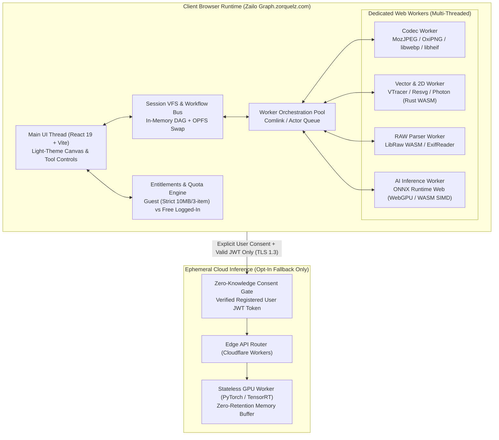
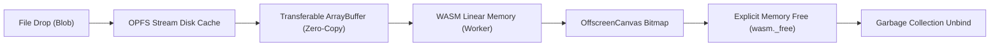
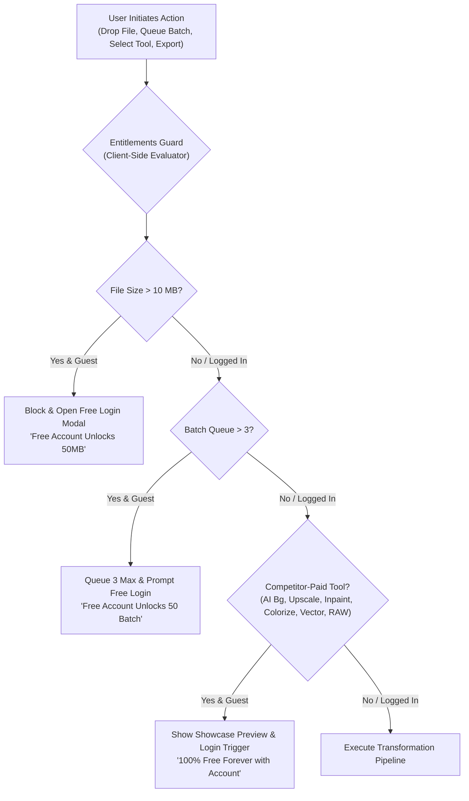
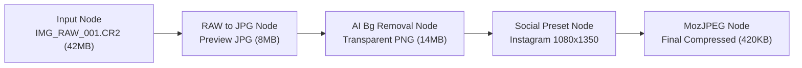
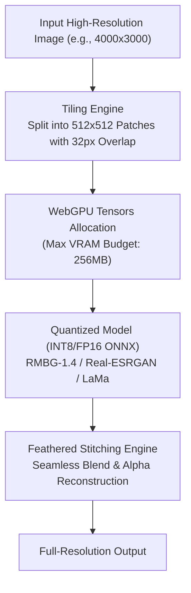
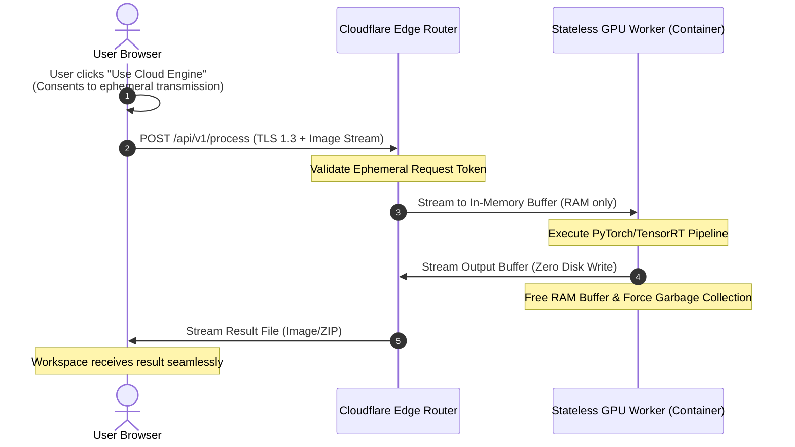

# Zailo Graph — Technical Architecture Blueprint

**Document Version:** 1.0.0  
**Target Domain:** `zailograph.zorquelz.com`  
**Architectural Model:** Local-First Hybrid Architecture  
**Status:** Approved Engineering Blueprint  

---

## 1. High-Level System Architecture

Zailo Graph is designed as a **client-dominated local-first web platform**. Over 80% of all operations execute entirely within the client's browser engine using WebAssembly (WASM), Web Workers, and WebGPU. High-compute generative AI operations and heavy RAW demosaicing implement a **hybrid execution model**: they run locally by default where client hardware permits, with an explicit, opt-in ephemeral cloud worker fallback.



---

## 2. Memory Model & Resource Lifecycle

### The 50 MB Image Memory Trap
A critical engineering challenge in browser-based image utilities is the distinction between **compressed file size** and **uncompressed RGBA pixel buffer size**.

$$\text{Decoded Memory} = \text{Width} \times \text{Height} \times 4\text{ bytes (RGBA)}$$

| File Format / Spec | File Size on Disk | Dimensions | Decompressed Pixel Memory |
| :--- | :--- | :--- | :--- |
| High-Res JPEG | 12 MB | $8,000 \times 6,000$ (48 MP) | **192 MB** per buffer |
| 50 MB Raw / PNG | 50 MB | $12,000 \times 8,000$ (96 MP) | **384 MB** per buffer |
| Intermediate Steps (3) | - | - | **$3 \times 384\text{ MB} = 1.15\text{ GB}$** |

If multiple intermediate buffers (original, canvas representation, WebAssembly linear memory copy, output buffer) are kept alive simultaneously, a single 50 MB photo can trigger Chrome's ~2 GB per-tab heap limit or crash mobile Safari ($< 1\text{ GB}$).

### Architectural Safeguards



1. **Zero-Copy Transfers (`Transferable Objects`):**  
   ArrayBuffers are transferred—not cloned—across the Web Worker boundary using `postMessage(buffer, [buffer])`, preventing memory duplication between the UI thread and worker threads.
2. **Deterministic WASM Heap Allocation:**  
   WebAssembly modules are allocated a static initial linear memory with automatic growth limits. Every memory allocation via `malloc` in C/Rust WASM modules is paired with an explicit `defer free()` in the corresponding wrapper.
3. **OPFS (Origin Private File System) Swapping:**  
   When working with large batches or high-resolution images, intermediate image payloads are stored in OPFS (browser-sandboxed virtual disk storage) rather than in the active JavaScript heap. Files are read as chunks/streams on demand.
4. **Explicit Object URL Revocation:**  
   Every preview image generated via `URL.createObjectURL(blob)` is tracked in a WeakMap/Registry and explicitly revoked via `URL.revokeObjectURL(url)` as soon as the DOM element unmounts or updates.

---

## 3. Authentication, Entitlements & Quota Enforcement Engine

Zailo Graph balances open accessibility with resource sustainability by implementing an in-browser **Entitlement & Quota Engine**. Anonymous guests can freely perform core image tasks with zero friction, while competitor-paid features (AI tools, vectorization, RAW conversion, 50MB files, 50-image batching) require a **100% free account login**.



### Architectural Enforcement Layers:
1. **File Ingestion Interceptor:** Checked synchronously on `dragover` / `drop` / `<input type="file">` before reading the file into OPFS or allocating ArrayBuffers. Rejects $>10\text{ MB}$ files for guests with zero memory allocation.
2. **Batch Queue Controller:** The `WorkerPoolManager` enforces a hard cap of 3 tasks for anonymous guests. Queuing a 4th file halts the queue and prompts the user to log in for free.
3. **Utility Route Guard:** Navigation to competitor-paid utilities (`ai-bg-removal`, `ai-upscale-4x`, `ai-inpainting`, `ai-colorization`, `vectorize-svg`, `camera-raw`, `svg-high-res-16x`) checks `useAuth().isAuthenticated`. For guests, a clean showcase card appears with sample before/after comparisons and a 1-click free registration prompt.
4. **Export Resolution Clamper:** The export serializer clamps guest raster outputs to max $1920 \times 1080\text{ px}$. Logged-in users export at native 100% unconstrained resolution (up to 8K / 96 MP).
5. **Cloud Fallback Gatekeeper:** The ephemeral cloud worker edge router (`api.Zailo Graph.zorquelz.com`) strictly verifies the signed user JWT. Anonymous requests to GPU compute routes are rejected with `401 Unauthorized` to prevent malicious DDoS exploitation of GPU resources.

---

## 4. Web Worker Pipeline & Concurrency Orchestration

The application utilizes a dedicated **Worker Pool Manager** to ensure the main UI thread never drops below 60 frames per second during heavy image operations.

### Worker Pipeline Topology

```
                  ┌────────────────────────────────────────┐
                  │          Worker Pool Manager           │
                  │  (Max Concurrent = CPU Cores - 1)       │
                  └───────────────────┬────────────────────┘
                                      │
           ┌──────────────────────────┼──────────────────────────┐
           ▼                          ▼                          ▼
┌────────────────────┐     ┌────────────────────┐     ┌────────────────────┐
│   Codec Worker 1   │     │   Codec Worker 2   │     │   AI/WASM Worker   │
│ (MozJPEG / OxiPNG) │     │ (WebP / LibHeif)   │     │  (ONNX / VTracer)  │
└────────────────────┘     └────────────────────┘     └────────────────────┘
```

### Scheduling & Prioritization
1. **Interactive Task Priority:** Interactive user adjustments (e.g., live crop, sharpening slider adjustment on the active canvas) take high-priority preemption over background batch queues.
2. **Batch Queue Throttling:** Batch queues run tasks sequentially or in parallel up to `Math.min(navigator.hardwareConcurrency - 1, 4)`. This guarantees at least one full core remains available for main-thread UI interactivity.
3. **Cancellable Pipelines with `AbortSignal`:** Every image processing worker supports cancellation. If the user adjusts a slider while a filter is computing, the active execution is aborted immediately via an internal WASM interruption flag or worker termination, preventing outdated renders from queuing up.

---

## 5. In-Memory Session Pipeline & Workflow Bus

To achieve the "connected workflow" requirement without repeated uploads, Zailo Graph implements an in-memory **Session Virtual File System (VFS)** based on a Directed Acyclic Graph (DAG).



### Session Node Architecture
Each node in the session DAG contains:
- `nodeId`: Unique UUIDv4.
- `parentId`: UUID of upstream source image.
- `utilityId`: Identifier of the tool executed (e.g., `ai-background-removal`).
- `params`: Exact configuration parameters (for reproducible non-destructive history).
- `handle`: Reference to the OPFS file handle or in-memory `Blob`.
- `previewBitmap`: Low-resolution ($512\text{ px}$) `ImageBitmap` kept in memory for instant UI rendering.
- `metadata`: Extracted EXIF/color space metadata preserved across transformations.

When a user selects **"Send to Background Removal"** from the RAW conversion tool, Zailo Graph simply passes the `nodeId` reference. No network call, disk download, or re-upload occurs.

---

## 6. Client-Side AI Inference Engine (WebGPU & WASM)

Client-side AI models run via **ONNX Runtime Web (`onnxruntime-web`)** leveraging WebGPU compute shaders, falling back to multi-threaded WASM with SIMD (Single Instruction, Multiple Data) when WebGPU is unavailable.

### AI Architecture & Memory Optimization



1. **Quantized Models:** All deployed ONNX models are quantized to INT8 or FP16 formats, reducing weight payloads from ~150 MB down to 25–45 MB.
2. **Model Cache API:** Model weights are fetched once and cached in the browser's native `CacheStorage`. Subsequent visits execute instantly from local disk cache with zero network overhead.
3. **Tiling Engine for Large Images:**  
   Passing a 50 MB (e.g., $8,000 \times 6,000$) image directly into a neural network would require dozens of gigabytes of VRAM and trigger immediate GPU driver reset (`device lost`). The engine partitions large images into overlapping tiles (e.g., $512 \times 512$ with 32 px overlap), runs inference tile-by-tile, and stitches them back together with linear blend feathering.

---

## 7. Ephemeral Cloud Inference Architecture (Opt-In Fallback)

When local execution is unfeasible (e.g., low-end mobile devices without WebGPU, ultra-large inpainting tasks, or heavy RAW demosaicing batches), users are offered the **Ephemeral Cloud Fallback**.



### Core Tenets of the Ephemeral Cloud Worker:
1. **Zero Persistent Storage:** The container runs on a read-only root filesystem with no mounted persistent block storage or S3 write permissions.
2. **RAM-Only Processing:** Image bytes exist exclusively in volatile memory buffers (`io.BytesIO`) during transformation and are immediately freed upon stream completion.
3. **Zero Analytics on User Content:** No thumbnails, file names, or metadata are logged. Only synthetic operational metrics (duration, memory consumption, HTTP status) are captured.

---

## 8. Storage, Caching, and Service Worker Architecture

### Storage Tiering Matrix

| Storage Layer | Technology | Contents | Retention Policy |
| :--- | :--- | :--- | :--- |
| **Volatile RAM** | JS Heap / WASM Memory | Active viewport `ImageBitmap`, tool UI states | Freed immediately when tool unmounts |
| **Virtual Disk** | OPFS (Origin Private File System) | Working intermediate files, batch queue inputs | Purged upon session close / "Clear Workspace" |
| **Persistent Cache** | Cache API | Static WebAssembly binaries (`.wasm`), AI models (`.onnx`) | Persisted indefinitely (invalidated on app release) |
| **Preferences** | IndexedDB / LocalStorage | User presets, custom watermark templates, export defaults | Persisted locally on user's device |

### Service Worker & PWA Capabilities
- All core application assets, WASM binaries, and UI code are cached using a `Cache-First` strategy via the Service Worker.
- All 20 pure-local utilities remain **100% operational offline** (airplane mode, zero connectivity).
- The PWA manifests support file associations: users can right-click an image in their desktop OS file manager and select *"Open with Zailo Graph"*.

---

## 9. Cross-Origin Isolation & High-Performance Buffers

High-throughput multi-threaded WebAssembly and WebGPU require high-precision timers and `SharedArrayBuffer` support. To unlock this in modern browsers, Zailo Graph enforces strict Cross-Origin Isolation headers:

```http
Cross-Origin-Opener-Policy: same-origin
Cross-Origin-Embedder-Policy: require-corp
Cross-Origin-Resource-Policy: same-origin
```

*Note: For external resources (such as OpenStreetMap tiles for EXIF GPS preview), assets are either proxied or loaded with `crossorigin="anonymous"` to ensure compliance without breaking isolation.*

